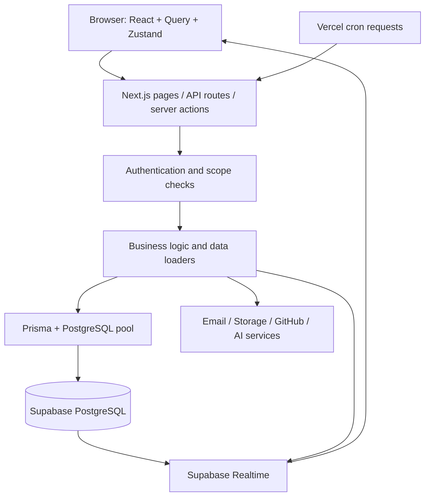

# Project Overview

Repository review: 5 September 2026. This is a concise overview of the source code and Prisma schema; deployed services and the live database were not tested.

## Purpose and technology

PEN Ticketing System is a multi-tenant support and work-management application. Organizations manage departments, sub-departments, projects, and tickets within one platform.

Features include Kanban boards, subtickets, sprints, modules, development/QA time tracking, public support forms, customer email conversations, automatic assignment, SLA monitoring, workflow rules, reports, notifications, and GitHub integration. Additional modules cover recruitment/video screening, tenant agreements, branding, and feature templates.

| Layer | Technology |
| --- | --- |
| Application | Next.js 16.2.7 App Router, React 19.2.4, TypeScript |
| UI | Tailwind CSS 4, shadcn/Base UI, Tiptap, React DnD |
| Client data/state | TanStack Query for server data; Zustand for shared client state |
| Database | Supabase PostgreSQL, Prisma 7, PostgreSQL driver adapter |
| Supporting services | Supabase Auth, Storage and Realtime; Resend email; Cloudflare R2 screening videos; AI integrations |
| Deployment/checks | Vercel configuration, Vitest, ESLint, TypeScript |

## Project structure

```text
src/
  app/                 Pages, layouts, server actions, and HTTP route handlers
    (dashboard)/       Boards, tasks, projects, reports, recruitment, settings
    platform/          Super-admin management
    departments/       Department selection and management
    support/           Public support forms and verification
    screen/            Candidate screening experience
    api/               Internal APIs, versioned APIs, webhooks, cron endpoints
  components/          Feature components, shared UI, providers, app shells
  hooks/               UI/realtime hooks; queries/ contains TanStack Query hooks
  store/               Zustand stores for tickets, timers, notifications, etc.
  lib/                 Business logic, permissions, data loaders, integrations
    api/               Browser-side HTTP wrappers
    supabase/          Browser, server, and admin clients
    reporting/         Report calculations and queries
    exports/           CSV, Excel, and PDF generation
    github/            GitHub event processing and ticket linking
    screening/         Video storage, transcription, and scoring
    mcp/               Tools exposed to external AI clients
  generated/prisma/    Generated Prisma client
  test/                Shared test support; tests also live beside source files
  proxy.ts             Session handling and tenant-aware URL rewriting
  instrumentation.ts   Runtime timezone setup
prisma/                Database schema, SQL migrations, seed script
public/                Static assets and service worker
scripts/               Setup, maintenance, and operational utilities
docs/                  Requirements, design notes, and project documentation
```

## Architecture and request flow

The application is a **modular monolith**: frontend and backend ship together as a Next.js application. Business capabilities are separated into modules, with orchestration also present in API routes.



Server components load initial data; interactive components call API routes through `src/lib/api/` and query hooks. Routes validate inputs, check access, update records, and invoke relevant assignment, SLA, automation, or notification logic. Realtime database events and broadcasts update client caches or refresh server-rendered views.

Vercel cron endpoints process SLA checks, availability, bulk reassignment, mailbox health, report exports/schedules, agreement reminders, and raw-payload cleanup. Ticket activity is recorded alongside current ticket state; realtime delivery is best-effort.

## Database design

The Prisma schema declares **82 models**. Core entities use relational foreign keys and membership/junction tables; JSON stores flexible settings, form responses, templates, and event metadata.

| Domain | Main models and relationships |
| --- | --- |
| Organization | `Tenant` has departments; `Department` has sub-departments. Projects and tickets also store `tenantId` for filtering. |
| Identity/access | `Profile`, `TenantMembership`, `RoleAssignment`, department access/member/manager tables, and `SubDepartmentMembership` connect users to organizational scopes. |
| Work | Each `Ticket` belongs to a sub-department and tenant; project, parent ticket, sprint, and module are optional. Assignment join tables support multiple agents and QA agents. |
| Collaboration | Tickets connect to comments, attachments, customer messages, activity logs, time entries, notifications, and explicit access grants. |
| Support intake | Forms own fields and submissions. `Intake` optionally links to one ticket; pending submissions and verified emails support email verification. |
| Automation/SLA | Policies, assignment rules, workflow rules/execution logs, one SLA timer per ticket, and breach history. |
| Operations | Mailbox connections, report jobs/schedules, audit events, agreements/documents, feature flags, and template grants. |
| Recruitment/integrations | Boards own fields/candidates; screening sessions own answers. GitHub PRs connect to tickets through a junction table. |

Ticket numbers are unique within a sub-department. Indexes support tenant, assignment, project, status, and due-date queries. Most entity IDs use CUIDs; profile IDs use UUIDs associated with authentication users. Some entities use soft deletion. Dynamic board statuses have stable categories: `OPEN`, `PAUSED`, `ESCALATED`, and `RESOLVED`.

Compatibility mappings preserve older database names: for example, `SubDepartment` maps to `Team`, and the agent/sub-manager enum values map to `staff`/`lead`.

## Access control and maintenance

Supabase authenticates users; server-side helpers enforce tenant, department, sub-department, and resource permissions. Roles include admin, manager, sub-manager, and agent, with a separate super-admin flag. Request context and a Prisma extension automatically scope reads for tickets, projects, departments, and sub-departments; other access paths depend on explicit checks.

The RLS helper documents that the application's database owner connection bypasses row-level security, making application-level checks essential. This review did not verify the deployed database role.

The shared database has documented migration drift. Schema changes require a reviewed migration, application to the shared database, migration registration, and client regeneration before merge. Never run `prisma migrate dev` or `prisma migrate reset` against it; follow [AGENTS.md](../AGENTS.md).

Useful entry points: [schema](../prisma/schema.prisma), [authentication](../src/lib/auth.ts), [database client](../src/lib/db.ts), [query scoping](../src/lib/prisma-scope.ts), and [deployment/cron configuration](../vercel.json).
